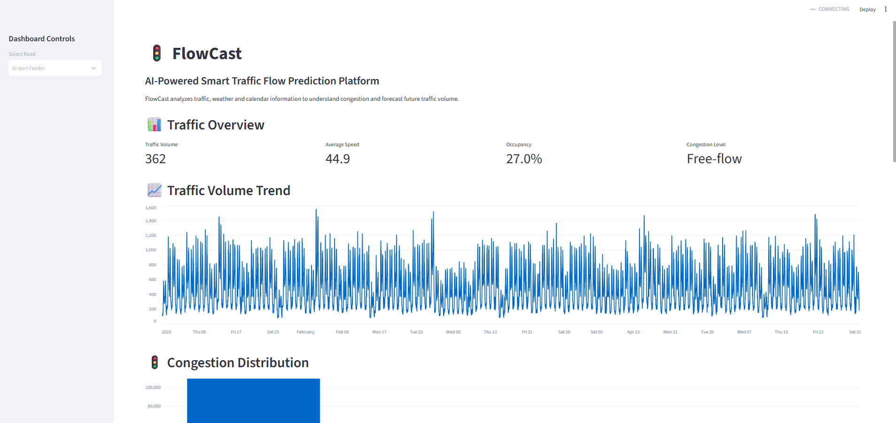

# FlowCast: AI-Powered Smart Traffic Flow Prediction Platform

FlowCast is an AI-powered traffic prediction platform designed to analyze traffic patterns, classify congestion levels, and forecast future traffic volume. It combines machine learning, deep learning, data analysis, and an interactive Streamlit dashboard to support smarter traffic monitoring.

## Project Overview

Traffic congestion affects travel time, road safety, fuel consumption, and transportation efficiency. FlowCast uses historical traffic, weather, and calendar data to identify congestion patterns and predict traffic conditions.

The project includes data cleaning, exploratory data analysis, feature engineering, machine learning classification, LSTM-based traffic forecasting, and an interactive dashboard.

## Key Features

* Traffic congestion classification using machine learning.
* Traffic volume forecasting using an LSTM neural network.
* Integration of traffic, weather, and calendar datasets.
* Data cleaning and preprocessing.
* Exploratory data analysis with visualizations.
* Time-based model evaluation.
* Interactive Streamlit dashboard.
* Model performance comparison using evaluation metrics.

## Dashboard Preview



The interactive dashboard displays traffic statistics, congestion patterns, weather information, model predictions, and traffic volume forecasts.

## Project Objectives

* Analyze historical traffic data to identify traffic patterns.
* Classify traffic into Free-flow, Moderate, Heavy, and Severe congestion levels.
* Predict future traffic volume using historical observations.
* Study the relationship between traffic, weather, and time-related features.
* Present the results through an interactive dashboard.
* Evaluate model performance using appropriate metrics.

## Datasets

FlowCast uses three datasets:

| Dataset                    | Description                                                                               |
| -------------------------- | ----------------------------------------------------------------------------------------- |
| `traffic_sensor_log.csv`   | Traffic volume, speed, occupancy, vehicle counts, congestion labels, and road information |
| `weather_observations.csv` | Weather conditions, temperature, rainfall, and visibility                                 |
| `calendar_events.csv`      | Public holidays, special events, and roadwork information                                 |

The original datasets are stored in `data/raw/`. The raw files are preserved separately from the cleaned and processed data.

## Data Processing Pipeline

1. **Data validation:** Checked dataset structure, missing values, duplicates, and invalid values.
2. **Data cleaning:** Removed duplicate traffic records and handled invalid numerical values.
3. **Missing-value handling:** Applied suitable imputation methods to numerical and weather data.
4. **Label handling:** Identified missing congestion labels and reconstructed them using a machine learning model, while retaining the original-label records separately for evaluation.
5. **Data standardization:** Standardized dates, timestamps, and weather categories.
6. **Data integration:** Combined traffic, weather, and calendar information.
7. **Feature engineering:** Created time-based, traffic-related, weather-related, and vehicle-distribution features.
8. **Exploratory data analysis:** Examined traffic distributions, congestion patterns, and hourly and daily trends.
9. **Model training and evaluation:** Trained and evaluated classification and forecasting models using time-based splits.

## Machine Learning Models

### Random Forest Classifier

Random Forest was used to classify traffic congestion into four levels.

* Accuracy: **98.36%**
* Macro F1-score: **97.09%**
* Weighted F1-score: **98.37%**

### XGBoost Classifier

XGBoost was used as the best-performing classical congestion classification model in the current experiments.

* Accuracy: **99.27%**
* Macro F1-score: **98.60%**
* Weighted F1-score: **99.27%**

### LSTM Traffic Forecasting Model

An LSTM neural network was developed to forecast traffic volume using historical traffic observations.

* Input sequence: 12 historical observations, representing approximately 6 hours.
* Forecast horizon: Next 30-minute traffic volume.
* MAE: **54.99**
* RMSE: **85.47**
* R² score: **0.9062**

The LSTM metrics evaluate a regression task and should not be compared directly with the classification accuracy scores.

## Feature Engineering

Important engineered features include:

* Hour, day of the week, month, and weekend indicator.
* Rush-hour indicator.
* Traffic volume-to-road-capacity ratio.
* Speed and vehicle-capacity ratios.
* Accident indicator.
* Rain, fog, and poor-visibility indicators.
* Vehicle-type distribution ratios.

These features help the models identify relationships between traffic conditions, road characteristics, weather, and time.

## Model Evaluation

A time-based split was used for the original-label classification experiments:

* **Training period:** January 1 – March 31, 2025.
* **Validation period:** April 1 – May 31, 2025.

The LSTM forecasting model was also evaluated using a chronological split, with scaling parameters learned from training data only.

Classification models were evaluated using accuracy, macro F1-score, and weighted F1-score. The LSTM model was evaluated using MAE, RMSE, and R².

## Important Data and Evaluation Note

Some congestion labels were missing in the original traffic dataset. These missing labels were reconstructed using a machine learning model.

The reconstructed labels are not treated as verified ground truth. The main classification evaluation uses records with original congestion labels to provide a more reliable assessment of model performance.

The reported metrics reflect the current experiments and may vary if the data, features, model settings, or evaluation process changes.

## Technologies Used

* Python
* Pandas and NumPy
* Scikit-learn
* XGBoost
* TensorFlow and Keras
* Matplotlib and Seaborn
* Streamlit
* Joblib
* Git and GitHub

## Project Structure

```text
FlowCast/
├── dashboards/
│   └── app.py
├── data/
│   └── raw/
│       ├── calendar_events.csv
│       ├── traffic_sensor_log.csv
│       └── weather_observations.csv
├── reports/
│   ├── figures/
│   ├── screenshots/
│   │   └── dashboard_overview.png
│   ├── FLOWCAST_MODEL_CARD.md
│   ├── classical_model_comparison.csv
│   └── model_comparison.csv
├── src/
│   ├── data processing scripts
│   ├── feature engineering scripts
│   ├── model training scripts
│   └── evaluation scripts
├── .gitignore
├── README.md
└── requirements.txt
```

## How to Run the Project

### 1. Clone the repository

```bash
git clone https://github.com/gullalaakshaya123-ctrl/FlowCast.git
cd FlowCast
```

### 2. Create a virtual environment

```bash
python -m venv .venv
```

### 3. Activate the virtual environment

On Windows PowerShell:

```powershell
.\.venv\Scripts\Activate.ps1
```

### 4. Install dependencies

```bash
pip install -r requirements.txt
```

### 5. Run the Streamlit dashboard

```bash
streamlit run dashboards/app.py
```

The dashboard will open in your browser.

**Note:** The dashboard uses locally trained model files and processed datasets. These generated files are not included in the GitHub repository by default, so the required data and models must be generated using the project scripts or made available locally before running the complete dashboard.

## Future Improvements

* Integrate real-time traffic sensor data.
* Improve forecasting with additional historical observations.
* Evaluate model performance on new and unseen traffic data.
* Add road-specific congestion alerts.
* Explore deployment through a cloud platform.
* Improve the dashboard for real-time traffic monitoring.

## Author

**Gullala Akshaya**

AI & ML Student | Artificial Intelligence and Machine Learning

## Repository

[View FlowCast on GitHub](https://github.com/gullalaakshaya123-ctrl/FlowCast)

---

*FlowCast demonstrates an end-to-end workflow for traffic data analysis, machine learning-based congestion classification, deep learning-based traffic forecasting, and interactive visualization.*
